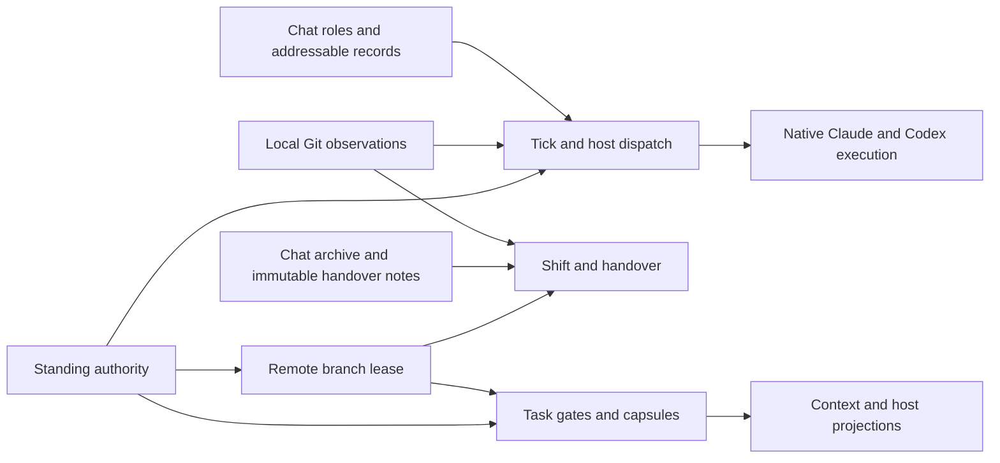

# Keel responsibility review for #527

Baseline: Keel 5.231.5 at `ac0da21a`. The checked-in inventory contains 38 published specs and the 5.231.5 full gate ran 428 scenarios. The four large files measured 3,463 lines (`bin/keel.js`), 2,490 (`gates.js`), 1,968 (`shift.js`), and 1,603 (`task-contract.js`). Size counts describe maintenance cost. They do not identify shared contracts by themselves.

| Boundary | Current owner and authority |
| --- | --- |
| Role identity and logical work | Worktree bindings, group membership and stable todo records in `src/core/chat/store.js`. Chat closure is a recorded declaration. |
| Git facts | `worktrees.js` lists linked checkouts and their local state. `sync.js` builds freshness and local-only classification on those shared facts. `branches.js` controls role/trunk selection and authorized prune. |
| Cross-device collaboration | `chat/archive.js` combines only `groups/cursors/members/presence/shift-notes` under `keel-chat`. Normal branch pushes move source history. `lock.js` controls per-branch coordination in separate lock refs. |
| Authority and task selection | `config.js` parses standing declarations. `task-contract.js` compiles an OpenSpec capsule and `gates.js` checks its fingerprint, evidence and optional branch lock. Projection is a disposable read view. |
| Handover and dispatch | `shift.js` owns old/new session handover, while `tick.js` orchestrates a host-scheduled pass over native routes. `codex-host.js` and Claude job commands retain native execution identity and results. |

## Disposition of the seven original observations

1. **Two locks.** Local collaboration resource leases serialize mutations in the common chat store. Cross-device leases arbitrate with remote branch refs and require ownership, generations, remote verification and publication policy. Retain both backends. A common display can report observations without changing either lifetime or authority.
2. **Git status duplication.** `sync.js` already reuses `worktrees.js` and `shift.js` consumes both. Branch pruning still performs a separate porcelain scan to determine checked-out branches. Reuse the central scanner for that identical fact. Keep separate comparisons for upstream divergence, all-remote publication, and containment in configured trunks because each answers a different question.
3. **Two remote channels.** #526 intentionally added immutable `shift-notes` to the chat archive. The rolling `shift/<role>.md` and locally cached transcripts and history remain device-local. Preserve the archive allowlist and sharing boundary, especially where a repo is public.
4. **Authorization vocabulary.** `device-sync` covers publishing lock refs. Publishing code and applying OpenSpec deltas have separate authorities. Keep their names to preserve deployed configs and narrow scopes.
5. **Push guard activation.** The old claim that it runs only with `push:<glob>` is superseded. A configured `sync.lock` independently denies a concrete push to a foreign-held branch. Branch and protected scopes limit branch pushes. Tag-only scopes leave branch pushes alone. Preserve the tested combinations and isolated guard boundary.
6. **Configuration declarations.** There are now 15 declarations in `CONFIG_DECLARATIONS`, the source of the actual set. Their error modes are feature-specific. A shared YAML parser or registry migration lacks evidence of behavior equivalence for partially readable configuration, so retain the already explicit parsers.
7. **Scale.** Keep observability facts and policy separate as the code grows. Pulling every Git subprocess behind one new interface would conflate result and error semantics and impose a broad compatibility task. The targeted scanner reuse gives a bounded first slice.

## Priority

The immediate refactor is the identical worktree observation in task 1.2. The shared execution receipt and writer-fencing work belongs to [#544](https://github.com/TanglmChris/keel/issues/544) and should reuse task and role identities. API or authorization redesign has no verified requirement from this audit.
